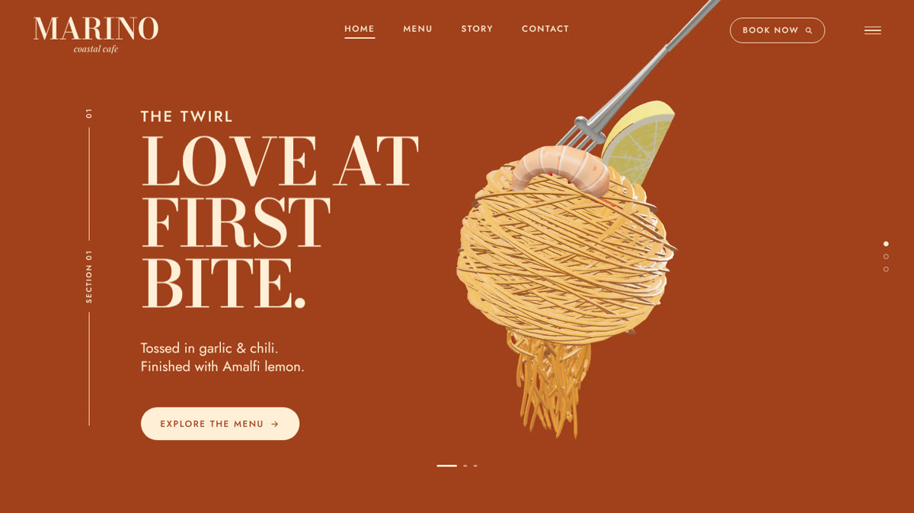
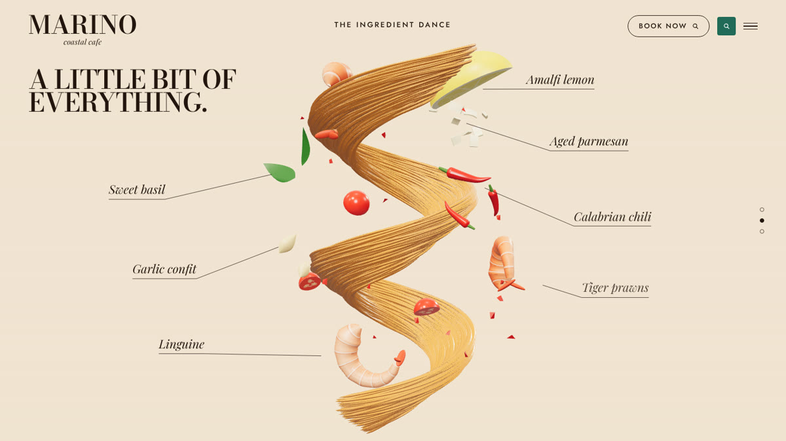
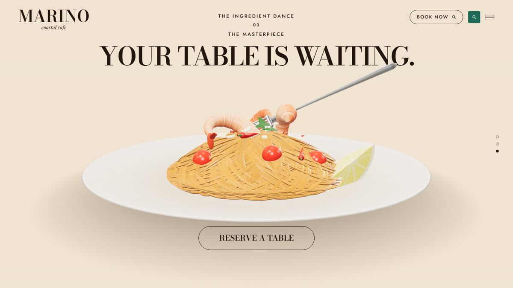

# Marino Cafe 3D

A scroll-driven 3D landing page for Marino Cafe. A forkful of shrimp linguine
unwinds into a spiral, its ingredients float out with labels, then everything
settles onto a plate.

| Hero | Ingredient dance | The masterpiece |
| --- | --- | --- |
|  |  |  |

## Stack

- [Vite](https://vite.dev) for dev server and build
- [Three.js](https://threejs.org) for the dish. Everything is modelled in code
  (no image or model assets): the pasta is ~170 GPU-animated strands that morph
  between three shapes, and the prawns, lemon, chili, tomato, garlic, basil,
  parmesan, fork and plate are procedural meshes with canvas textures.
- [GSAP](https://gsap.com) + ScrollTrigger for the load-in timeline and scroll progress
- [Lenis](https://lenis.darkroom.engineering) for smooth scrolling
- Fonts via Fontsource: Bodoni Moda (display), Jost (UI), Playfair Display italic (labels)

## Run it

```bash
npm install
npm run dev      # http://localhost:5173
npm run build    # static site in dist/
```

## How the story works

The page is one tall section (`.story`, 640vh) with a sticky full-screen stage.
Scroll progress `p` (0 to 1) drives both the DOM and the WebGL scene; the beat
ranges live in `BEATS` in `src/three/scene.js`.

| p | What happens |
| --- | --- |
| 0 – 0.14 | Rust hero panel scrolls away, cream stage is revealed, nav switches theme |
| 0.03 – 0.30 | Twirled pasta unwinds from the fork into a vertical ribbon spiral |
| 0.15 – 0.36 | Ingredients fly out; labels and leader lines draw in |
| 0.56 – 0.68 | Labels fade, the spiral tightens into a tornado |
| 0.64 – 0.84 | Plate rises, pasta and ingredients drop onto it, "Your table is waiting." |
| 0.82 – 0.90 | Reserve button appears |

Files:

- `src/three/noodles.js`: pasta strands; shape functions live in GLSL injected into `MeshStandardMaterial`
- `src/three/ingredients.js`: procedural ingredients and their hero / spiral / plate poses
- `src/three/scene.js`: renderer, lights, responsive layout and per-frame blending
- `src/main.js`: intro timeline, scroll wiring, nav/title/label updates and leader lines

`window.__marino.setProgress(0.42)` jumps to any point in the story, which is handy for screenshots.
